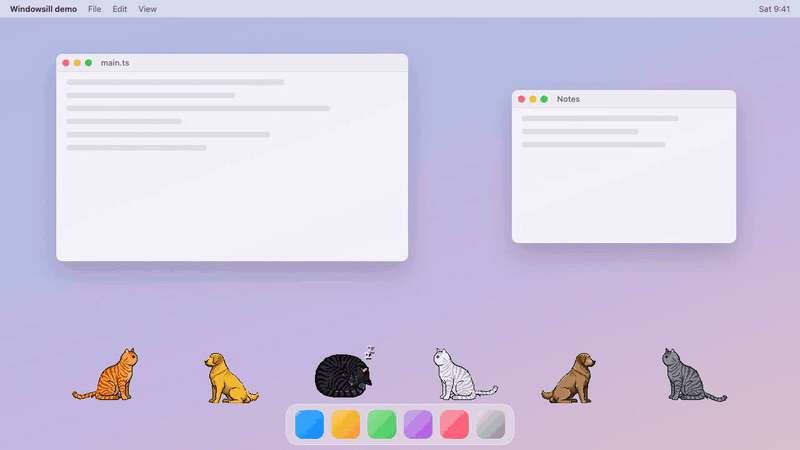

# Windowsill

> Little cats, and soon dogs, that live on your Mac's desktop. Pet them, teach them tricks, and let them nap on your windows while you work.

Run the demo locally: `npm run dev` then open `/demo.html`.

---

## A cat on your screen

Desktop pets used to be a small joy: a creature that shared your screen and made a long day feel less lonely. Windowsill brings that back with cats that feel alive.

Each **pet** has a name, a look, a personality and a mood. It naps above your Dock, wanders, grooms a paw and gets into mild trouble when you forget about it. You stroke it with the cursor and it purrs. You teach it tricks, and it actually learns them, one reward at a time.

**A desktop pet should make work feel warmer without ever getting in the way of it.** Clicks pass straight through to your apps everywhere except on a pet.

## What it feels like

### 🐾 Make a pet
Pick a **species** (cats first, dogs in Phase 2), a **name**, a **style** (pixel first; soft and cute, ink doodle and silhouette later), a **coat** (cats: orange tabby, black, white, grey, tuxedo, calico, Siamese; dogs: golden, black, white, brown, spotted, tricolour, husky grey) and a **personality**: Cosy, Curious, Mischievous or Social. It drops in from the top of the screen and lands on its feet.

### 💤 It lives alongside you
Mostly calm: napping, loafing, stretching awake, wandering a little. Curious cats explore, cosy ones curl up near your cursor when you step away.

### 💕 Pet it
Stroke a cat back and forth with the cursor, no click needed. It purrs, little hearts rise, and a happy cat rolls onto its back. Pick one up by the scruff and drop it; it always lands on its feet.

### 🎵 Teach it tricks
Right-click a cat for the cue ring: whistle, clap, toy wand or treat bag. The cat guesses a trick (spin, sit up, roll over, high five, chase tail). Pet it if it got it right. After a few rounds the whistle really means spin, and every cat learns its own pairings. Forget to practise and the trick slowly fades.

### 😼 Mood matters
Ignore the cats while you work and they get naughty: zoomies, staring at your cursor, cheeky wrong tricks. A few strokes bring them back. Only time you're actually at the computer counts, so they don't wake up grumpy every morning.

### ✨ Optional Gemma
If you run [Ollama](https://ollama.com) with a Gemma model, cats get in-character thought bubbles ("sun spot. mine."), and later you'll be able to talk to them, get name ideas and read their daily diary. Without it, everything else works the same.

## Privacy

No accounts, no telemetry, no analytics. Nothing leaves your computer except, if you turn Gemma on, calls to Ollama on your own machine. Cats never look at your screen, your windows' contents or your typing.

## Status

**Designing, not built yet.** The product spec and the Phase 1 plan are done; code comes next.

| Phase | Scope |
|-------|-------|
| **1 (MVP)** | Pixel cats on the floor of the screen, click-through, create and remember cats, mood, petting, pick up and drop, cue ring tricks, menu bar menu, macOS build |
| **2** | Dogs, cats walk on top of your windows, cursor play, cats playing together, hide during fullscreen apps, Gemma thought bubbles |
| **3** | Soft, ink and silhouette styles, talk to them, name help, daily diary, cursor-wave cues, multiple monitors |

## Tech

[Tauri 2](https://v2.tauri.app) with Rust for the Mac parts (transparent always-on-top overlay, click-through, screen area, idle time, menu bar, save file) and TypeScript with [PixiJS 8](https://pixijs.com) for the pets. The pet brain (mood, behaviour, trick learning) is plain, unit-tested TypeScript.

The art is GenAI pixel art drawn as cut-out parts (body, head, ears, eyes, tail, legs) plus a few key poses. Code animates the parts, and an art pipeline (`npm run art`) turns generated images into crisp, consistent sprite sheets.

## Releasing

Push a `vX.Y.Z` tag. The release workflow builds a universal `.dmg` (Apple Silicon and Intel) into a draft GitHub Release, so nothing is published until you review it. Builds are unsigned until the Apple signing secrets are added.

## Docs

- [Product specification](docs/product.md): what Windowsill does, precisely
- [Phase 1 implementation plan](docs/superpowers/plans/2026-10-31-windowsill-phase-1.md): the build, task by task
